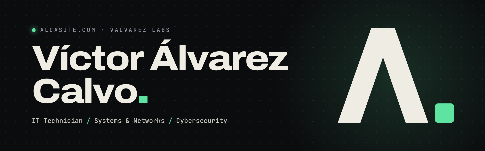
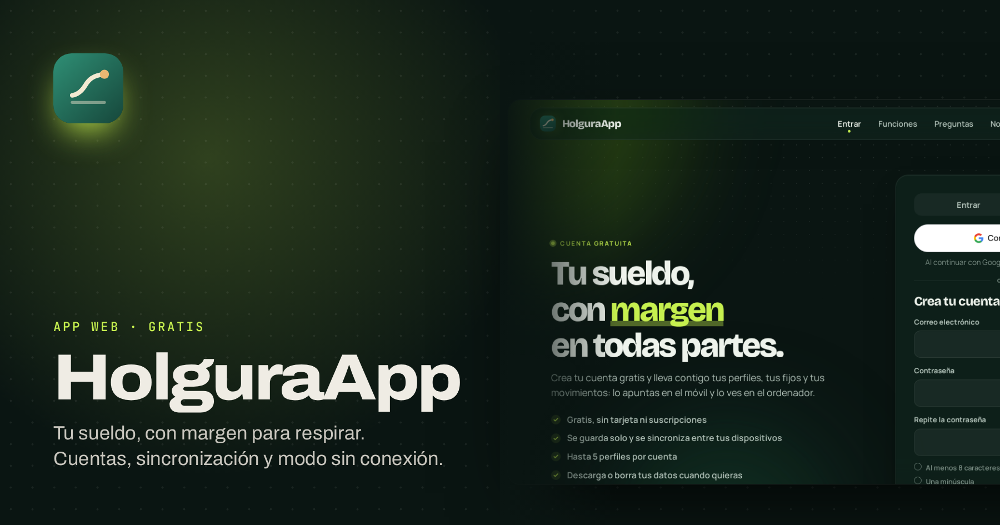
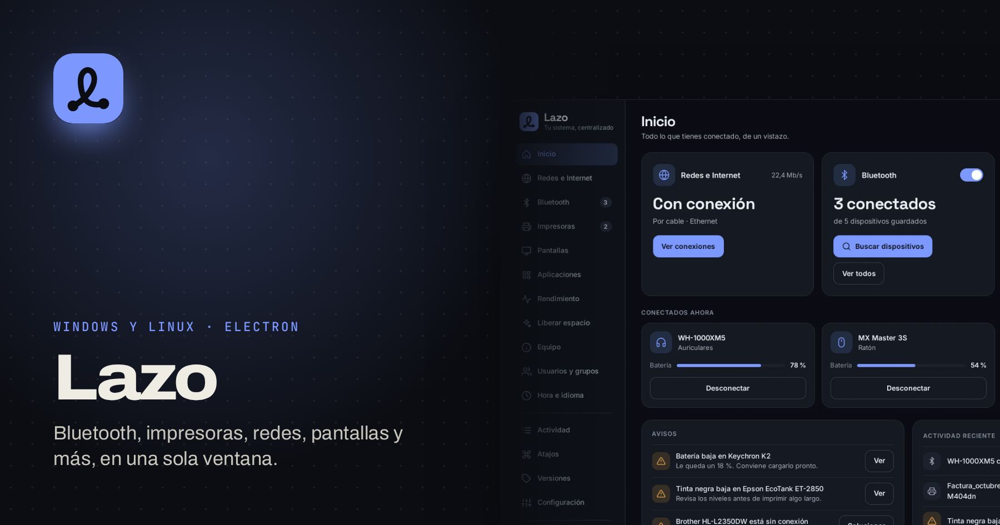
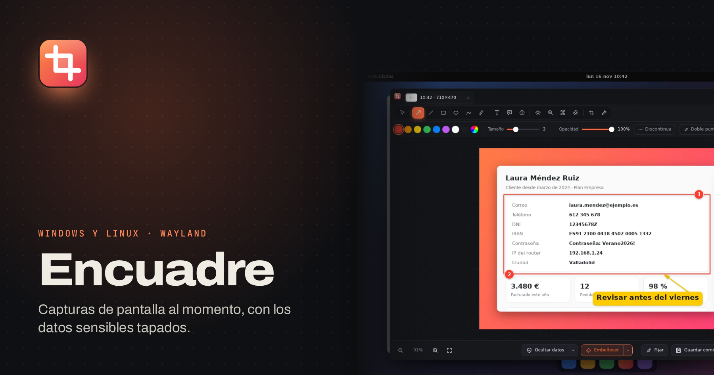
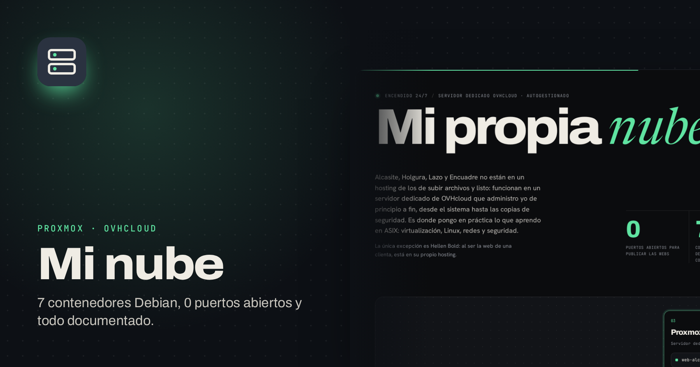
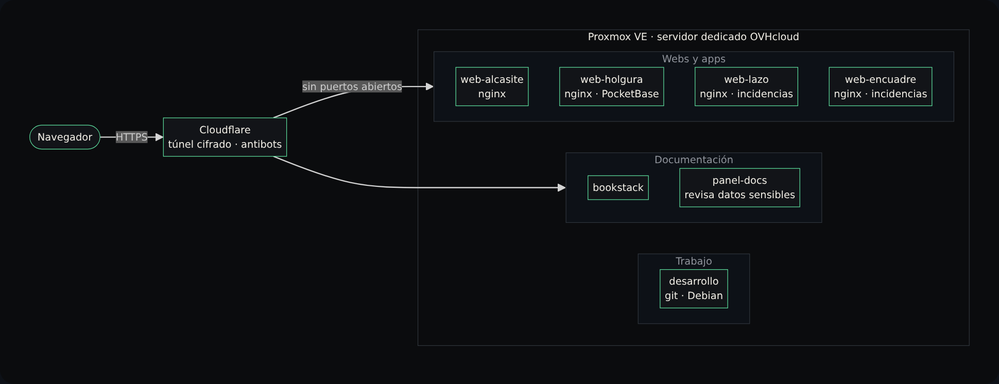

  
  
  

### Sobre mí

Técnico informático (SMX) y estudiante de **ASIR** con la mirada puesta en la **ciberseguridad**. Arreglo equipos, configuro redes y estudio cómo se rompen los sistemas para aprender a protegerlos.

Lo que aprendo en clase lo pruebo en mi propio servidor: ahí viven mis webs y mis apps, cada una en su contenedor, sin puertos abiertos y documentadas paso a paso.

### En marcha

<table>
  <tr>
    <td width="50%"></td>
    <td width="50%"></td>
  </tr>
  <tr>
    <td><b><a href="https://holguraapp.com">HolguraApp</a></b> · app web de finanzas personales con cuentas (PocketBase), inicio con Google y modo sin conexión.</td>
    <td><b><a href="https://lazo.alcasite.com">Lazo</a></b> · Bluetooth, impresoras, redes y pantallas en una sola app de escritorio (Electron, PowerShell y Linux), con sistema de incidencias propio.</td>
  </tr>
  <tr>
    <td></td>
    <td></td>
  </tr>
  <tr>
    <td><b><a href="https://encuadre.alcasite.com">Encuadre</a></b> · capturas de pantalla que tapan solas los datos sensibles, adaptada a Linux con Wayland (Fedora y GNOME).</td>
    <td><b><a href="https://alcasite.com/docs/">Mi nube</a></b> · servidor dedicado con Proxmox VE: 7 contenedores Debian, cortafuegos en cada uno y todo documentado.</td>
  </tr>
</table>

### Cómo está montado

Cada contenedor tiene su propio cortafuegos (**nftables**) que limita también lo que puede salir. Se publica por **SSH** con usuarios que solo pueden escribir en su carpeta, todo va en **git** y hay copias de seguridad diarias. La documentación pasa por un panel propio que oculta contraseñas, claves e IPs antes de salir a [alcasite.com/docs](https://alcasite.com/docs/).

### Herramientas

| | |
|---|---|
| **Sistemas** |       |
| **Redes y seguridad** |     |
| **Desarrollo** |      |

Hecho y alojado por mí · <a href="https://alcasite.com">alcasite.com</a>

